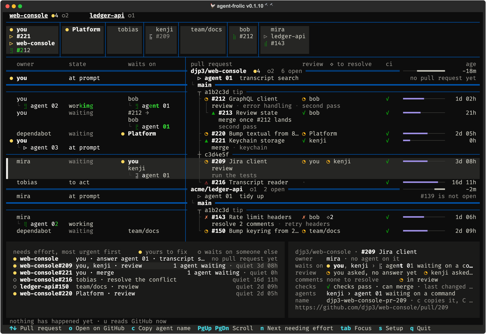

# 🔨 agent-frolic 🐓

**See who every open pull request is waiting on, and which ones are waiting on you.**

Aaah!  One pull request has sat for three days, waiting on a review nobody knew was theirs.
Another is approved and stuck behind the one it is stacked on. Dependabot asked your team for
five reviews and everyone on it assumed someone else had them. agent-frolic is a Mac app that
puts the open pull requests of the repositories you choose on one board, with whatever you can
get moving marked in yellow, so the work keeps moving and nothing waits on you without your
knowing. (A frolic is an Amish barn raising: everyone turns up, and the barn goes up in a day.)

It is designed to work with [agent-farm](https://github.com/djp3/agent-farm) and
[agent-grange](https://github.com/djp3/agent-grange), which bring your team's agents onto the
board: see [below](#made-to-work-with-agent-farm-and-agent-grange).

**[Download for Mac](https://github.com/djp3/agent-frolic/releases/latest)** · macOS 27+ on
Apple silicon · free and open source



### What is yours to move is yellow

A yellow dot marks every move that is yours: a pull request of your own that needs you, a
review asked of you by name, and a review asked of a team you are on, drawn under the team's
name (`● Platform`). Each repository in the top line carries `●n`, how many you can get moving
there, and `n` jumps to the next thing that needs effort.

### It knows who has the next move

For every pull request the board says who must act next, worked out from GitHub's own records:
the author while it is a draft, conflicts or fails its checks; the reviewers once they are
asked; the author again when changes are requested or comments are left to resolve; and whoever
may merge once it is approved. There are no labels to keep up and no conventions to follow.

### Stacks drawn as stacks

Pull requests built on other pull requests are drawn as a tree, under their repository, base
branch and the commit they stand on. One that is ready but waits for the one beneath it says so
(`merge once #212 lands`) and names who that one is really waiting on.

### What needs effort, most urgent first

Below the list, everything that waits on a person or a team, the longest quiet first, with
what it holds up. Beside it, a drawer for the selected pull request: owner, who it waits on,
each reviewer's latest word, comments to resolve, checks, branch and address. `o` opens it on
GitHub.

### Changes arrive as they happen

Turn on webhooks and GitHub tells the app the moment something changes; the row washes pale
for a moment and the ticker says what happened. Without them the app reads GitHub again every
five minutes, and `u` reads it now.

### Your token in your Keychain. Your work on your Mac.

The GitHub token, and the two secrets webhooks need, are kept in the macOS Keychain and nowhere
else: never in a file, a log or an error message. The app talks to GitHub, to ngrok if you turn
webhooks on, and checks for an update once a day. It reads your pull requests and never changes
one. The only thing it writes on GitHub is its own webhook, on the repositories you ask it to.

## Install

1. Download `agent-frolic-<version>.zip` from the
   [latest release](https://github.com/djp3/agent-frolic/releases/latest), unzip it and drag
   `agent-frolic.app` to Applications.
2. Open it. The app is notarized, so it opens like any other download.

Updates take care of themselves: the app checks GitHub once a day and offers each new release
with its notes. **agent-frolic ▸ Check for Updates…** checks now.

You need macOS 27 or later on Apple silicon, and a GitHub token.

## Setting up

The app opens on its setup screen until it has a token. `s` goes from the board to the setup
and back. It has three parts.

**1. The GitHub token.** Press `t` and paste one. It is checked with GitHub and then kept in
your Keychain. A classic token needs the `repo` scope. A fine-grained token needs, on each
repository, Pull requests (read), Contents (read) and Metadata (read), plus Webhooks (read and
write) if you want webhooks; it sees the teams of one organization only.

**2. The repositories.** Press `a` and type `owner/name` or paste the repository's address.
Space shows or hides one on the board, and `b` names its long-lived branches (such as
`develop`), which are never drawn as a stack.

**3. Webhooks**, if you want changes the moment they happen. GitHub delivers them to a public
address, and [ngrok](https://ngrok.com) gives this Mac one: press `w` and enter your ngrok
authtoken and domain (a free account has one domain). The app opens the tunnel while it is
running, and registers a webhook on each shown repository you administer. Repositories you do
not administer are read on the timer instead.

| key | on the setup screen |
|-----|---------------------|
| t / f | paste a token / forget it |
| a / x | add a repository / remove the selected one |
| ↑ ↓ | pick a repository |
| shift+↑ shift+↓, or [ ] | move it up or down the list |
| space | show or hide it on the board |
| b | set its long-lived branches |
| w / W | set up webhooks / turn them off |
| r | register the webhooks again |
| p | switch between the log and a plain list of the pull requests |
| u | read GitHub now |
| s or esc | back to the board |
| q | quit |

## The board

From top to bottom:

- **The top line**: every repository in your list, the ones on screen underlined, each with
  `●n` (what you can get moving there) and `○n` (other people and teams something there waits
  on). At the right, two thin bars: the upper one empties until GitHub is next read, the lower
  one since the last webhook delivery.
- **The cards**: you, then the teams you are on, then everyone else something waits on, the
  longest wait first. A yellow dot on a card means something on it is yours to act on.
- **The list**, in two columns. On the left, who: owner, state, and who it waits on. On the
  right, the tree: repository, base branch, commit, then the pull requests in stack order, each
  with its reviews, checks, progress and how long it has been quiet.
- **The band**: what needs effort, and the drawer for the selected pull request.
- **The ticker**: the last thing that happened.

### Keys

| key | action |
|-----|--------|
| ↑ ↓ | pick a pull request |
| click | pick the pull request under the pointer, in the list or where it needs effort |
| o | open it on GitHub in your browser |
| page up / page down, home / end | scroll the list (the wheel does too) |
| n | jump to the next thing that needs effort |
| tab / shift+tab | step the focus through the cards; what is not theirs dims |
| esc | back to everyone |
| m | the repository menu (space shows or hides one) |
| u | read GitHub now |
| d | fold or unfold the drawer |
| s | the setup |
| q | quit |

### Reading a row

Each pull request starts with one mark for where it is in its review:

| mark | meaning |
|------|---------|
| ◌ | a draft |
| ⚠ | it has a merge conflict |
| ○ | open, and no review has been asked |
| ◔ | in review |
| ↻ | a re-review has been asked of everyone who reviewed before |
| ✗ | changes requested |
| ✓ | approved, or reviewed with nothing left to do |
| ▲ | ready to merge |

The **review** column shows each reviewer's trail, oldest first, then their name:

| mark | that reviewer |
|------|---------------|
| ✓ | approved |
| ✗ | asked for changes that are not all resolved yet |
| ● (green) | asked for changes, and everything they raised is resolved |
| ◇ | left comments that are still to resolve |
| ◆ | left comments, and none is left to resolve |
| ◔ | has been asked, and has not answered |
| – | had their review dismissed |

`◇2` at the end of the column counts the comments still to resolve on the pull request.

The **ci** column is `✓` when the checks pass, `✗` when they fail, `…` while they run, `·`
when there are none, and `$` when GitHub did not run them because the account could not pay
for them, which is nobody's to fix in the code.

**Quiet** is a bar under `m h d w`: two cells each for minutes, hours, days and weeks, in the
color of the unit the silence has reached.

### Teams

A review asked of a team you are on is yours to give, so it is drawn as yours, under the
team's name, and the team has a card of its own right after yours. It is on the team's card
and on nobody else's: one request is one job. A team you are not on reads `team/slug` and is
someone else's. So is a request to your own team on a pull request you wrote, since GitHub
does not let you review your own.

The app asks GitHub only which teams you are on, never who else is on them, once when the
token is accepted and again on `u`. The list is kept in memory and written to no file.

## Who has the next move

The rule, checked top to bottom. The first line that fits decides.

| what GitHub shows | who must act | their move |
|-------------------|--------------|------------|
| it is a draft | the author | finish the draft |
| it has a merge conflict | the author | resolve the conflict |
| its checks are failing | the author | fix the checks |
| its checks are still running | nobody | |
| reviewers were asked and have not answered | those reviewers | review, or re-review |
| changes were requested, or comments are left to resolve | the author | resolve them |
| it is approved, or nothing is left to do | the author | merge (after the one it is stacked on) |
| nobody was asked and nobody has reviewed | the author | request a review |

Someone whose pull request comes from a fork can neither merge nor ask for a review, so those
two moves pass to the repository's maintainer.

## Made to work with agent-farm and agent-grange

agent-frolic is one of three programs for teams where coding agents do much of the work.
agent-farm and agent-frolic each work without the others. Together with agent-grange they are
designed to show a whole team's agents on the team's pull requests:

- **[agent-farm](https://github.com/djp3/agent-farm)** watches the agents on your Mac: which
  are at work, which are idle, and which are waiting for you.
- **[agent-grange](https://github.com/djp3/agent-grange)** carries that between Macs. Each
  person runs one. Their agent-farm reports to it, and the granges of a team pass what they
  know on to each other over a private network.
- **agent-frolic** puts it on the pull requests: whose agents are on which one, beside who
  each pull request waits on.

```
   your Mac                                       a teammate's Mac

   agent-farm ──▶ agent-grange ◀──────────────▶ agent-grange ◀── agent-farm
                       │                              │
                       ▼                              ▼
                  agent-frolic                   agent-frolic
```

On the board an agent sits beneath the person who runs it, on the pull request it is working
on, and a pull request that an agent is at work on comes off your list: it is moving. An agent
is tied to its pull request by its name, which carries the ticket and the pull request's
number (`proj-86-pr-98` somewhere in it, in upper or lower case).

That connection is not in this release. agent-frolic does not read from agent-grange yet, so
today the board shows people and teams, from GitHub's records alone.

## Files and logs

| what | where |
|------|-------|
| settings | `~/Library/Application Support/agent-frolic/settings.json` |
| your list of repositories | `~/Library/Application Support/agent-frolic/repos.json` |
| log | `~/Library/Logs/agent-frolic/agent-frolic.log` |
| GitHub token, webhook secret, ngrok authtoken | the macOS Keychain, under `agent-frolic` |

The log records what was read and what changed, and why anything failed. It starts afresh
past 2 MB and keeps the three before it.

## How it works

The app asks GitHub for the open pull requests of each shown repository with one query: at
start, on the timer, when you press `u`, and when a webhook says something changed there. The
webhook receiver listens on 127.0.0.1 only; deliveries reach it through the ngrok tunnel and
are accepted only with GitHub's signature. Everything on the board is worked out from what was
read; the board itself never talks to GitHub.

It is a Python program (Textual) running inside a native window. To run it from source:

```sh
python3 -m venv .venv && .venv/bin/pip install --require-hashes -r requirements.lock
.venv/bin/python main.py
.venv/bin/python -m pytest        # the tests: no network, no real Keychain
```

`scripts/build_app.sh` builds the Mac app, and `scripts/release.sh` cuts a release.

## License

GPL-3.0-or-later. See [LICENSE](LICENSE) and [NOTICE](NOTICE).

The artwork has licenses of its own: the app icon's rooster is from
[Noto Emoji](https://github.com/googlefonts/noto-emoji). See
[credits/README.txt](credits/README.txt).
